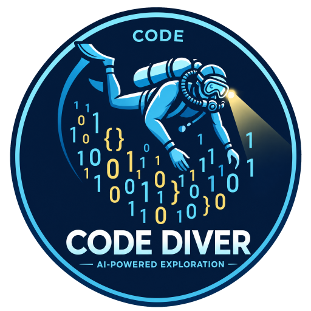

<p align="center">
  
</p>

<h1 align="center">CodeDiver</h1>

<p align="center">
  <b>Visual code exploration for developers — and the AI agents helping them.</b>
</p>

<p align="center">
  <a href="https://github.com/aitakemyjob/codediver/actions/workflows/ci.yml"></a>
  <a href="https://github.com/aitakemyjob/codediver/releases/latest"></a>
  
  <a href="LICENSE"></a>
  <a href="https://scorecard.dev/viewer/?uri=github.com/aitakemyjob/codediver"></a>
</p>

CodeDiver is a desktop app that turns a repository into things you can *see*:
call graphs, "how does execution get here?" traces, control-flow graphs of a
single function with its inputs and outputs, dependency maps, type diagrams,
heatmaps of churn, complexity and change, and a QA view of what your tests
actually cover. It ships a built-in
[MCP](https://modelcontextprotocol.io) server, so Claude Code, Cursor, VS Code
and other agents can drive the UI while they explain code to you — and
propose changes you review visually before anything touches disk.

## Features

| | |
|---|---|
| **Trace to here** | Click any function to see every path from entry points (including HTTP handlers registered as values) to it. |
| **Function logic** | Control-flow graph with branches, loops, early returns, `defer`/`go` and panics, plus an inputs → function → outputs card. Agents pin step-by-step narration onto the matching blocks. |
| **File summary** | One click lists every function (inputs → outputs, complexity, callers/callees), type, variable, constant and import in the open file. |
| **Call graphs** | Callers, callees or both; interface calls resolved to their concrete implementations. |
| **QA view** | Line coverage from your own test tooling (Go, LCOV, Cobertura, JaCoCo), every test as a readable behavior with the code it exercises, functions ranked by test risk with the hard-wired dependencies that make them hard to test, and coverage markers in the editor gutter. Agents read it over MCP and post test plans you review. |
| **Heatmaps** | Treemap of the repo by churn, working-tree diff, pending agent proposals, complexity, agent attention, size or uncovered lines, with per-function drill-down. |
| **Visual review** | Git diffs (working tree, staged, any two refs) mapped to the functions they touch, plus a blast-radius graph of affected callers. |
| **Agent proposals** | Agents submit edits; you get side-by-side diffs, a heatmap and an impact graph, then accept or reject per file with feedback. |
| **Walkthroughs & diagrams** | Agents present guided code tours and Mermaid or interactive diagrams whose nodes link to code. |
| **Themes** | Deep Dive (default), Abyss, Obsidian, Tokyo Night, Nord, Dracula, Gruvbox, Synthwave, Paper and Solarized Light. |

### Language support

| Level | Languages | What you get |
|---|---|---|
| **Precise** | Go | Type-checked call graphs with interface dispatch, control-flow graphs, struct fields, `implements`, variables and constants. |
| **Lexical** | TypeScript, JavaScript, Python, Rust, Java, Kotlin, C#, C, C++, Ruby, PHP, Swift, Scala, Dart, Lua | Functions, classes, parameters, docs and complexity; name-matched call edges (marked `~`); import graphs for most. |
| **Everywhere** | ~80 languages | Syntax highlighting, search, git history and diffs, heatmaps, proposals, walkthroughs and agent explanations. |

## Install

**macOS / Linux**

```sh
curl -fsSL https://raw.githubusercontent.com/aitakemyjob/codediver/main/scripts/install.sh | sh
```

**Windows** (PowerShell)

```powershell
irm https://raw.githubusercontent.com/aitakemyjob/codediver/main/scripts/install.ps1 | iex
```

Or grab a file from [Releases](https://github.com/aitakemyjob/codediver/releases/latest):

| Platform | Download |
|---|---|
| macOS (Apple Silicon + Intel) | `codediver_darwin_universal.zip` |
| Windows | `codediver_windows_amd64_installer.exe` or the portable `.zip` |
| Linux x64 / ARM64 | `.deb`, `.rpm` or `.tar.gz` |
| Headless server (`codediver serve`, any OS) | `codediver-headless_<os>_<arch>` |

Linux needs WebKitGTK 4.1 (`sudo apt install libwebkit2gtk-4.1-0`), and every
platform needs `git` on `PATH` for history features. macOS builds are not yet
notarized; the install script clears the quarantine flag for you.

**Verifying a download:** every file is listed in `checksums.txt`, and each
release carries signed build provenance, so you can confirm a file was built
by this repository's release workflow:

```sh
gh attestation verify codediver_linux_amd64.deb --repo aitakemyjob/codediver
```

Each release also includes an SPDX SBOM listing every Go and npm dependency.

## Quick start

1. Launch CodeDiver and **Add a repository**.
2. Connect your agent (the **MCP** pill in the title bar shows these too):

   ```sh
   # Claude Code
   claude mcp add --transport http codediver http://127.0.0.1:47474/mcp
   ```

   ```jsonc
   // Cursor (~/.cursor/mcp.json)
   { "mcpServers": { "codediver": { "url": "http://127.0.0.1:47474/mcp" } } }
   // VS Code (.vscode/mcp.json)
   { "servers": { "codediver": { "type": "http", "url": "http://127.0.0.1:47474/mcp" } } }
   // Claude Desktop and other stdio-only clients
   { "mcpServers": { "codediver": { "command": "codediver", "args": ["mcp"] } } }
   ```

3. Ask things like *"Using CodeDiver, walk me through how an order request is
   handled"*, *"explain the function I have open"* or *"what's the riskiest
   untested code here? Show me a test plan."* With **Follow agent** on,
   whatever the agent shows opens in front of you.
4. Open **QA** (flask icon) and click **Run coverage** to add line coverage;
   CodeDiver detects the command for Go, Vitest/Jest, pytest, Cargo, Maven,
   Gradle and .NET projects, or imports a report you already have.

Shortcuts: `Ctrl/⌘ K` palette · `Alt+T` trace to here · `Alt+L` logic flow ·
`Alt+G` call graph · `Alt+S` file summary · `Ctrl/⌘ Shift H` heatmap ·
`Ctrl/⌘ Shift G` review changes · `Ctrl/⌘ B` sidebar · `Ctrl/⌘ I` inspector.

## Command line

```
codediver                 launch the desktop app
codediver serve           headless; open the same UI in your browser
codediver mcp             stdio MCP bridge to the running app
codediver version
  -port N   MCP/HTTP port (default 47474)   -add PATH   add a repository first
```

## Safety model

- Agents only see repositories you add, and each can be hidden from agents.
- Everything goes through a sandbox: no `..` or symlink escapes, `.git` is
  never exposed, and secrets (`.env*`, `*.pem`, `*.key`, `id_rsa*`, …) plus
  your own per-repo globs are invisible.
- Agents cannot write files. `propose_changes` stores a proposal; only you can
  apply it, and CodeDiver refuses to overwrite a file that changed since.
- Agents cannot run commands. Coverage suites (detected from `go.mod`,
  `package.json`, `pyproject.toml`, … and editable in the QA view) run only
  when you click **Run coverage**; agents only read the results.
- The server binds to `127.0.0.1`, rejects non-loopback `Host` headers (DNS
  rebinding) and requires a custom header plus same-origin for the UI API.

## Building from source

You need **Go 1.25+** and **Node 22+**. The build scripts install the Wails CLI
if it's missing.

| Platform | Prerequisites | Build |
|---|---|---|
| Linux | `sudo apt install libgtk-3-dev libwebkit2gtk-4.1-dev` (Fedora: `gtk3-devel webkit2gtk4.1-devel`); optional [`nfpm`](https://nfpm.goreleaser.com) for .deb/.rpm | `scripts/build.sh --package` |
| macOS | Xcode command-line tools (`xcode-select --install`) | `scripts/build.sh --package` |
| Windows | [WebView2](https://developer.microsoft.com/microsoft-edge/webview2/) (preinstalled on Windows 11); optional NSIS for the installer (`choco install nsis`) | `scripts\build.ps1 -Package` |

Without `--package` the app lands in `build/bin`; with it, release artifacts
land in `dist/`. Other useful commands:

```sh
scripts/build.sh --platform linux/arm64     # pick a target (macOS defaults to universal)
scripts/build.sh --headless --package       # no-webview binaries for every OS/arch
make test                                   # Go (race) + frontend tests
make dev                                    # hot-reload development
make help                                   # everything else
```

## Releasing

Releases are cut from version tags. From a clean `main`:

```sh
make release VERSION=v0.2.0
```

That runs the tests, then creates and pushes an annotated tag. The
[Release workflow](.github/workflows/release.yml) then verifies the tag,
re-runs the tests, builds every platform with the same scripts as above
(Linux amd64/arm64, macOS universal, Windows, plus headless binaries),
writes `checksums.txt`, an SPDX SBOM and signed build provenance, and publishes
a GitHub release whose notes are grouped by PR label
([`.github/release.yml`](.github/release.yml)). Update
[CHANGELOG.md](CHANGELOG.md) before tagging. Tags with a suffix like
`v1.0.0-rc.1` become pre-releases. To sign and notarize macOS builds, add the
`MACOS_CODESIGN_IDENTITY`, `APPLE_ID`, `APPLE_TEAM_ID` and
`APPLE_APP_PASSWORD` repository secrets.

## Contributing

Contributions are welcome! Start with [CONTRIBUTING.md](CONTRIBUTING.md), browse
[good first issues](https://github.com/aitakemyjob/codediver/labels/good%20first%20issue),
and please follow the [Code of Conduct](CODE_OF_CONDUCT.md). Questions go to
[Discussions](https://github.com/aitakemyjob/codediver/discussions); security
reports to [SECURITY.md](SECURITY.md).

## Documentation

- [Architecture](docs/ARCHITECTURE.md) — packages, design principles, how to extend
- [MCP tool reference](docs/MCP.md) — every tool agents can call
- [Contributing](CONTRIBUTING.md) — setup, conventions, branding and releases
- [Roadmap](ROADMAP.md) — what's planned for 0.2, 0.3, 0.4 and 1.0
- [Changelog](CHANGELOG.md) — notable changes per release

## License

[MIT](LICENSE)
